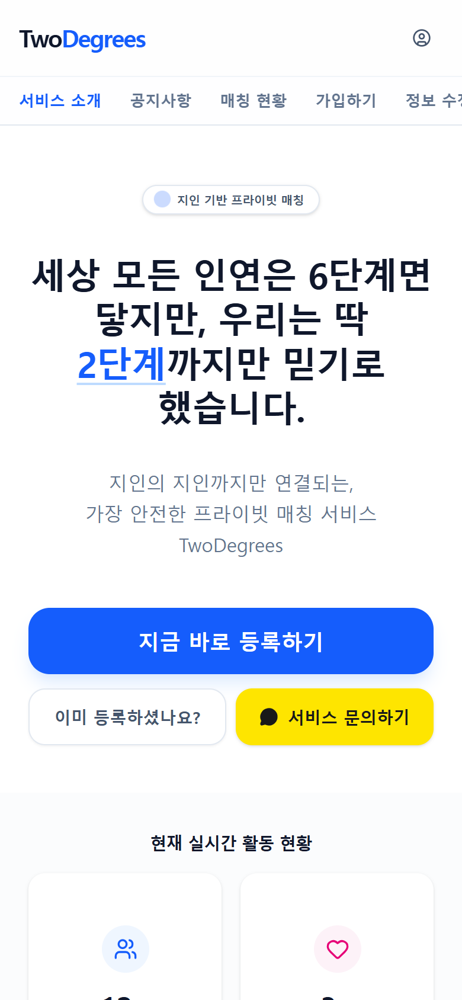
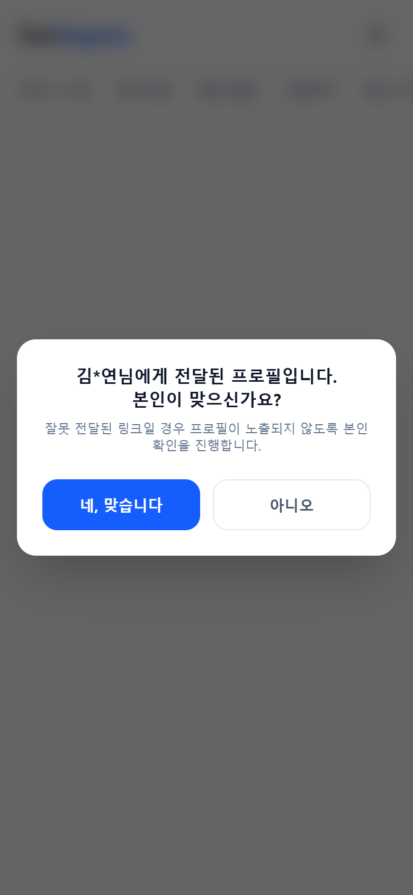
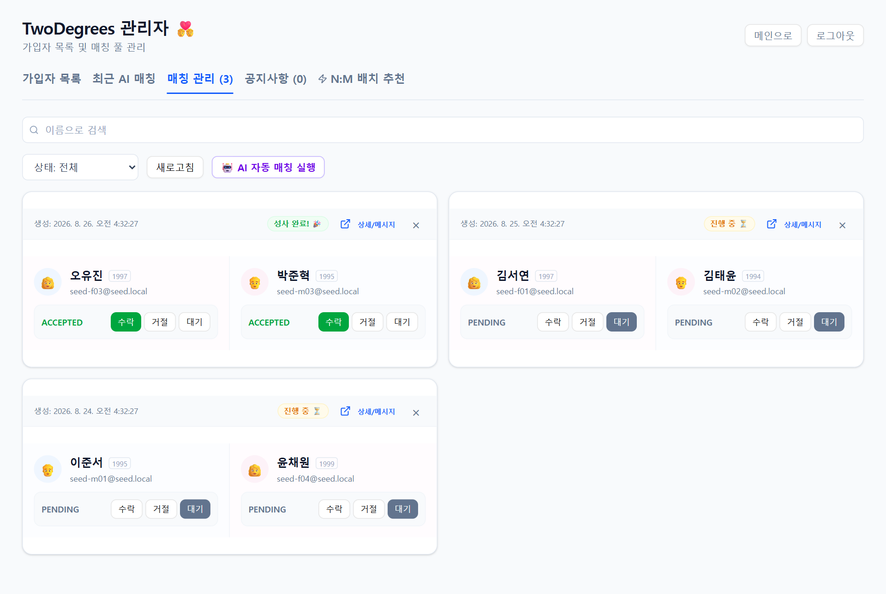
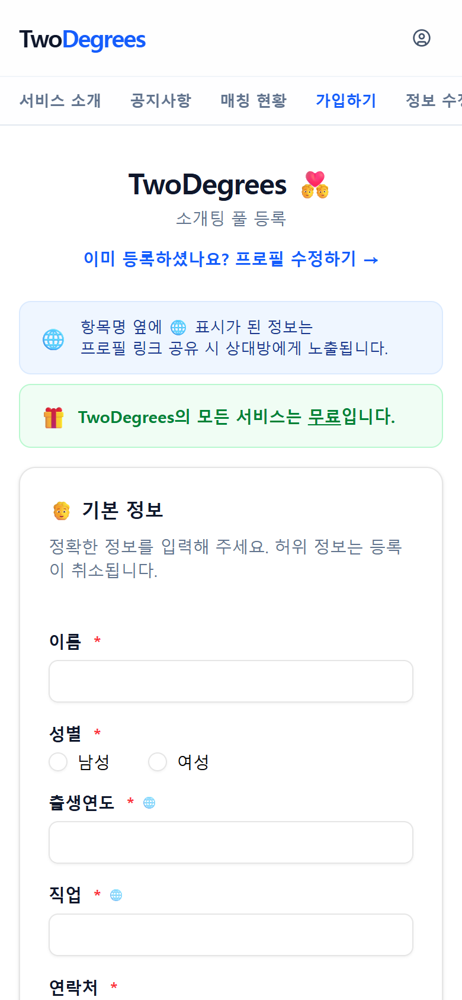
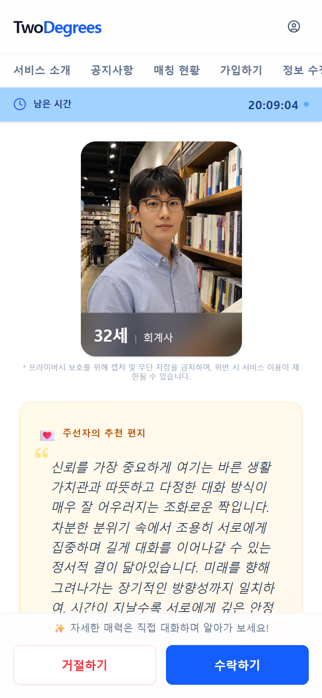
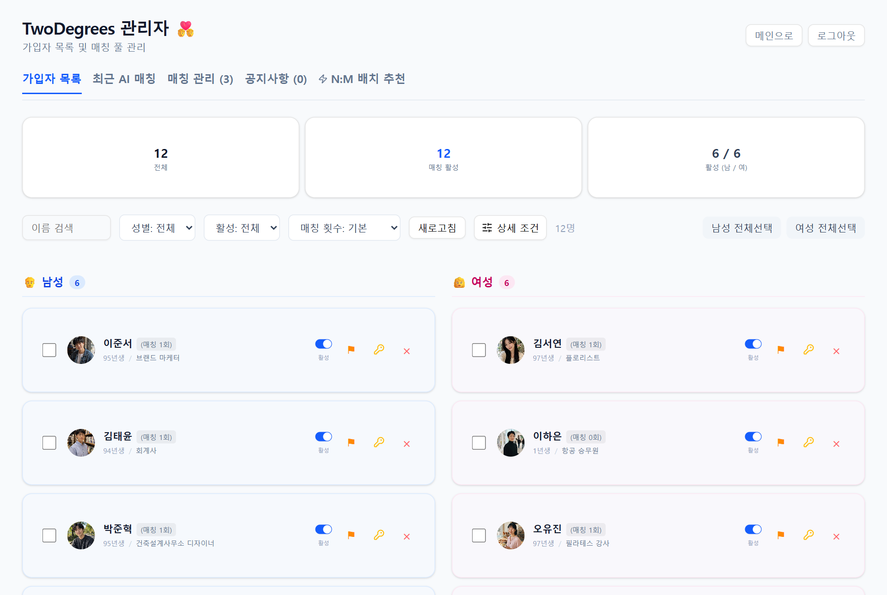
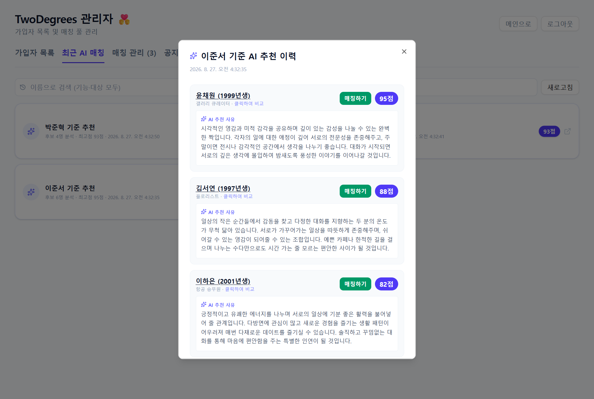
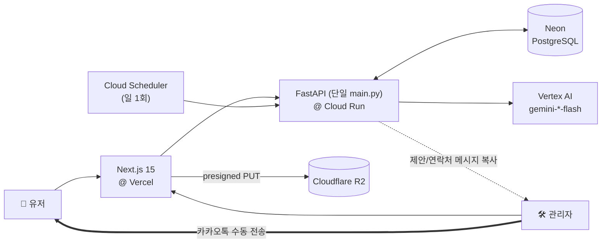

# TwoDegrees (투디그리)

> 지인 범위 안에서 등록된 조건을 AI로 평가하고, 링크로 프로필을 공유해 소개팅을 주선하는 큐레이션 웹 서비스. 1인 취미 프로젝트로 무료 운영.

| | |
|---|---|
| **운영 기간** | 2026-03 ~ 2026-08 (약 6개월) |
| **상태** | 🔴 **종료** — 매칭 성사율이 기대만큼 나오지 않아 운영 동기를 잃음 |
| **규모** | 유효 가입 61명 · 생성된 매칭 119쌍 · 양측 수락 11쌍 (9.2%) |
| **성격** | 1인 취미 프로젝트 · 무료 · 지인의 지인 대상 (유입은 처음부터 소규모로 의도) |
| **형태** | 모바일 웹 (Next.js) · 관리자 운영 도구 포함 |

이 문서는 6개월 운영하고 접은 취미 프로젝트의 회고입니다. 잘 돌아간 부분과 왜 접었는지를, 종료 전에 뽑은 [익명 집계 지표](metrics/summary.md)에 근거해 정리했습니다.

### 스크린샷

<!-- 아래 이미지는 모두 시드 데이터 화면입니다 (docs/screenshots/README.md) -->

| 랜딩 | 프로필 공유 링크 (본인확인) | 관리자 매칭 |
|---|---|---|
|  |  |  |

---

## 1. 왜 만들었나

소개팅을 시켜달라는 지인들의 부탁이 계속 있었습니다. 처음엔 머릿속과 메모로 관리했는데 — 누구와 누구가 맞을지, 이미 소개한 조합은 무엇인지, 서로의 조건이 충돌하지는 않는지 — 사람이 늘수록 감당이 안 됐습니다. 그걸 정리할 겸 도구로 만들어 본 것이 이 프로젝트입니다.

지인 범위라 신원·성향의 신뢰는 이미 확보돼 있다고 봤고, 남은 수작업을 덜고 싶었습니다.

| 수작업 | 도구가 대신한 것 | 대가 |
|---|---|---|
| "이 둘이 맞을까" 판단 | 양쪽의 원하는/기피 조건(자유 텍스트, 최소 10자)을 Gemini가 쌍방향으로 채점 | 매칭 시도마다 LLM 호출 비용 |
| 프로필 주고받기 | 24시간 만료되는 링크로 상대 프로필 공유 + 본인확인 게이팅 | — |
| 진행 상황 추적 | 매칭별 상태(제안·수락·거절·종료)와 페널티 관리 UI | — |
| 재소개 방지 | 같은 추천인끼리, 이미 매칭된 조합은 후보에서 자동 제외 | — |

제안 링크와 성사 후 연락처는 운영자가 카카오톡으로 직접 보냈습니다. 카카오 메시지 API(알림톡·친구톡)는 사업자등록이 있어야 쓸 수 있는데 개인 프로젝트라 그게 없었고, 그래서 수동 발송이 됐습니다. 돌이켜보면 지인 소개라는 성격과는 오히려 맞는 방식이었습니다 (→ [5. 왜 접었나](#5-왜-접었나)).

---

## 2. 핵심 기능

### 사용자 플로우

| # | 단계 | 화면 / 엔드포인트 | 설명 |
|---|---|---|---|
| 1 | 프로필 등록 | `/register` · `POST /api/users` | 다단계 폼. 필수: 이름·성별·출생연도·직업·연락처·추천인·원하는 조건·기피 조건. 선택: 키·지역·MBTI·흡연·음주·종교·결혼/자녀관·희망 나이차 등 |
| 2 | 사진 업로드 | `GET /api/upload/presigned-url` | 브라우저가 presigned URL을 받아 Cloudflare R2에 **직접 PUT**. 백엔드는 이미지를 경유하지 않음 |
| 3 | 로그인 | `/auth` · `POST /api/users/auth` | 연락처 + 비밀번호. 세션/토큰 없이 `user_id`만 반환 |
| 4 | 매칭 대기 | `/matching-status` | 진행 중 매칭 상태 확인 |
| 5 | 제안 수신 | (카카오톡) → `/p/[token]` | 운영자가 보낸 링크. **본인확인 모달** 통과 후 상대 프로필 열람 |
| 6 | 수락 / 거절 | `POST /api/shared/{token}/respond` | 양측 수락 시에만 연락처 교환 |
| 7 | 프로필 수정 | `/edit` · `PUT /api/users/{id}` | `is_active` 토글로 풀 노출 on/off |




상대 프로필 응답에서는 **이름·연락처·자기소개 원문이 스키마 레벨에서 제거**됩니다 (`SharedProfileRead`). 나이·직업·지역·사진·AI 추천 사유만 전달됩니다.

### 관리자 기능 (`/admin`, Google OAuth)

| 기능 | 엔드포인트 | 설명 |
|---|---|---|
| 유저 목록 · 복합 필터 | `GET /api/users` | 성별·연령·지역·흡연·음주·종교·MBTI·키·결혼/자녀관·희망 나이 교차 필터 |
| AI 추천 (1:N) | `POST /api/matchings/ai-recommend` | 타겟 1명 vs 후보 N명 Gemini 채점. 기매칭·진행중·동일 추천인·정지 유저 자동 제외 |
| AI 배치 추천 (N:M) | `POST /api/matchings/ai-batch-recommend` | Greedy Assignment로 상위 `top_n` 쌍 |
| 매칭 생성 / 제안 발송 | `POST /api/matchings` · `PATCH .../refresh-expiry` | 쌍 확정 → 링크 만료 24h 설정 → 제안 메시지 클립보드 복사 |
| 매칭 종료 처리 | `PATCH .../contact-shared` | 양측 수락 → 두 유저 비활성화. 거절·무응답 → 페널티(거절 1.0 / 무응답 1.5, 누적 3.0↑ 시 14일 정지) |
| 공지 관리 | `POST/PUT/DELETE /api/notices` | 팝업 공지 지원 |

전체 API는 [`docs/api-summary.md`](docs/api-summary.md), 스펙은 [`docs/openapi.json`](docs/openapi.json).




---

## 3. 아키텍처

전체 다이어그램(시스템 구성 + 매칭 라이프사이클 시퀀스): [`docs/architecture.md`](docs/architecture.md)
데이터 모델: [`docs/erd.md`](docs/erd.md) · 의존성: [`docs/stack.md`](docs/stack.md)



| 구성요소 | 선택 | 이유 (당시 판단) |
|---|---|---|
| 프론트 | **Next.js 15 (App Router) @ Vercel** | GitHub 연동 자동 배포, 무료 티어, 모바일 우선 |
| 백엔드 | **FastAPI 단일 파일 @ GCP Cloud Run** | 1인 개발 — 파일 분리보다 한눈에 보이는 것을 우선. Cloud Run은 scale-to-zero + 요청 200만/월 무료 |
| DB | **Neon (서버리스 PostgreSQL)** | 무료 티어, 서버리스라 유휴 시 과금 없음. 로컬은 SQLite로 동일 코드 실행 |
| 이미지 | **Cloudflare R2** | egress 무료, 10GB 무료. presigned URL로 백엔드 대역폭 절약 |
| LLM | **Vertex AI** (`gemini-2.5-flash` → `3.6-flash`) | Cloud Run 서비스 계정 ADC로 키 관리 불필요. 로컬은 AI Studio(`GEMINI_API_KEY`) 폴백 |
| 배치 | **Cloud Scheduler** → `POST /api/internal/generate-daily` | Cloud Run 다중 인스턴스에서 in-process 스케줄러가 중복 실행되는 문제를 피하려고 외부 단일 트리거로 분리 |
| 관리자 인증 | **Google OAuth → 자체 JWT(24h)** | 비밀번호 관리 회피. 허용 이메일 화이트리스트 |
| 알림/전달 | **없음 (수동)** | 카카오 메시지 API는 사업자등록이 필요해 개인 프로젝트라 미사용. 카카오 채널은 문의용 외부 링크일 뿐이고, 제안·연락처는 운영자가 수동 전송 |

> ⚠️ 무료 티어를 전제로 골랐지만 실제로는 유지되지 않았습니다 (→ [6. 회고](#6-회고--다시-만든다면)).

---

## 4. 기술적으로 짚을 만한 것

### AI 추천 결과 캐싱 (타겟당 1행 병합·덮어쓰기)

같은 후보를 반복 채점하지 않도록, `ai_recommend_histories`에 타겟별로 최근 이력을 캐시합니다.

```python
# main.py — ai_recommend_matchings
recent_histories = (db.query(AiRecommendHistory)
    .filter(AiRecommendHistory.target_user_id == payload.target_user_id)
    .order_by(AiRecommendHistory.created_at.desc()).limit(10).all())
cached_candidate_ids = candidate_id_set & set(cached_results.keys())
new_candidate_ids    = candidate_id_set - cached_candidate_ids   # 이 후보만 Gemini 호출

# 결과 병합 후 "가장 최신 1행"을 덮어쓴다
latest_hist.candidate_results = {**cached_results, **new_api_results}
latest_hist.created_at = datetime.now(timezone.utc)
```

- **장점**: 호출 비용 절감, 스케줄러가 캐시를 공유.
- **대가**: 타겟당 사실상 1행만 남아 **"몇 번 호출했고 캐시가 몇 번 맞았는지"를 사후에 복원할 수 없다.** 종료 후 캐시 히트율을 계산하려다 이 설계 때문에 불가능했다 (→ [회고: 관측 가능성](#6-회고--다시-만든다면)).

### 공유 링크 — 토큰 + 본인확인 게이팅

```python
# 링크당 256비트 토큰 (models.py)
user_a_token = Column(String(100), unique=True,
    default=lambda: secrets.token_urlsafe(32))

# GET /api/shared/{token} — 3중 게이트
if not matching:                      raise HTTPException(404)   # 토큰 불일치
if expires_at_utc < now:              raise HTTPException(410)   # 24시간 경과
if current_status != MatchStatus.PENDING: raise HTTPException(403)  # 이미 응답함
```

서버는 위 조건을 통과하면 **PII를 뺀** 프로필과 함께 "링크를 받은 사람의 이름"을 내려줍니다. 클라이언트는 프로필을 그리기 전에 전체 화면 오버레이로 `"○○○님에게 전달된 프로필입니다. 본인이 맞으신가요?"`를 띄우고, "아니오"면 프로필을 렌더링하지 않습니다 (`select-none`, 우클릭 차단 등 스크린샷 억제도 포함).

- **의도**: 링크가 엉뚱한 사람에게 전달돼도 사진·상세가 노출되지 않게.
- **한계 (정직하게)**: 본인확인은 클라이언트 오버레이라 **PII를 제거한 페이로드 자체는 브라우저에 도달**한다. 이름·연락처·자기소개는 애초에 응답에 없지만, "렌더링 차단 = 데이터 차단"은 아니다.

### 일일 자동매칭 스케줄러

```python
# _run_generate_daily_matches — 하루 실행분
while successful_matches < 2 and attempts < 10:
    male, female = random.choice(cur_males), random.choice(cur_females)
    if male.referrer_name == female.referrer_name: continue   # 같은 추천인 제외
    if pair_key in matched_pairs: continue                    # 재매칭 제외
    score = pair_cache.get(pair_key) or gemini_score(male, female)  # 캐시 우선
    if score < 50: continue                                   # 임계값
    if _get_busy_user_ids(db) & {male.id, female.id}: continue  # 커밋 직전 재검증
    create Matching(is_auto_generated=True)
```

랜덤 페어링 + 임계값 + 커밋 직전 재검증(Gemini 호출 사이에 다른 매칭이 생길 수 있으므로)의 조합. **문제는 이 루프가 사용자 활동과 무관하게 매일 돈다는 것** — 종료 직전 30일 신규 가입이 약 5건인데 스케줄러는 30회 실행됐다. 게다가 AI가 채점한 후보쌍의 54.7%는 임계값 미달로 매칭조차 되지 않았다.

### Gemini 프롬프트 — 한국어 매칭 톤

```python
# main.py — Gemini 호출 전, 프로필 JSON에서 이름·추천인·사진 제외
exclude_fields = {"name", "referrer_name", "photo_urls"}

# utils/gemini.py
# 1) LLM이 36자 UUID를 그대로 복사하지 못해 결과가 통째로 유실되던 문제
#    → 후보를 짧은 라벨로 치환해 요청하고, 응답에서 실제 UUID로 되돌린다
label_to_id = {f"B{i+1}": c["id"] for i, c in enumerate(candidates)}

# 2) system_instruction: "전문 소개팅 주선자" 페르소나
#    - 쌍방향(대칭) 평가: A의 기피조건에 B가 걸리면 대폭 감점, 그 역도
#    - 사내연애 방지: 같은 직장이면 가산점 금지
#    - reason 필드는 "스펙 나열 금지 / 원문 인용 금지 / 3인칭 화법"의 추천 편지
config = {"response_mime_type": "application/json",
          "thinking_config": {"thinking_level": "LOW"}}
```

`reason`은 유저가 프로필을 열 때 처음 읽는 문장이라, 점수보다 이 문장의 톤에 프롬프트 지침의 대부분을 썼습니다.

---

## 5. 왜 접었나

전체 지표: [`metrics/summary.md`](metrics/summary.md) (종료 전 운영 DB·GCP 결제·모니터링에서 추출한 익명 집계)

**직접적인 이유는 낮은 매칭 성사율입니다.** 지인 범위 큐레이션이면 성사율이 높을 거라 기대했는데, 6개월간 119쌍을 만들어 **양측이 모두 수락한 건 11쌍(9.2%)**이었습니다. 운영자가 직접 고르고 AI 점수도 평균 78.6점이었던 매칭들이 그랬습니다. 여기서 서비스를 계속 이끌 동기가 꺾였습니다.

| 관찰 | 근거 수치 |
|---|---|
| **성사율이 낮다** | 119쌍 → 11쌍(9.2%). 양측 응답이 끝난 86쌍 기준으로도 12.8%. 응답 완료 매칭의 80%+(69쌍)에 거절이 최소 1건 |
| **AI 점수가 성사를 예측하지 못했다** | 실제 생성된 매칭의 AI 점수는 평균 78.6·중앙값 83인데 성사율은 9.2%. 반대로 AI가 채점한 후보쌍 148개 중 54.7%는 임계값(50점) 미달, 중앙값 40점 |
| **작은 풀에서 조건이 잘 안 맞았다** | 활성 풀 여성 33 : 남성 11. 나이 조건까지 반영하면 여성 1인당 매칭 가능한 남성 후보가 중앙값 3명, 가장 많은 사람도 6명 |
| **동기를 잃은 뒤에도 비용은 계속 났다** | 자동매칭 스케줄러가 매일 실행. 6개월 GCP 지출 ₩16,627 (LLM ₩10,582, 약 64%), 수익 0 |

> 유입이 적었던 것(종료 직전 30일 `/register` 방문 8명, 검색·SNS 유입 사실상 0)은 취미로 지인 범위에만 연 결과라 처음부터 예상한 부분이고, 종료 사유가 아닙니다.

---

## 6. 회고 — 다시 만든다면


### ① "지인 큐레이션 = 좋은 매칭"이라는 가정이 약했다

지인이 부탁했다고 두 사람이 서로 맞는 건 아니었다. 성사 11쌍과 나머지 사이에서 뚜렷한 신호를 찾고 싶었지만, 자유 텍스트 조건은 실제 호불호를 덜 담았고 그걸 검증할 데이터도 부족했다.
→ **다음엔**: 등록 시 조건을 자유 텍스트 대신 구조화된 항목 + 우선순위로 받는다. 성사/거절 결과를 매칭에 라벨로 붙여 둔다.

### ② AI 적합도 점수를 성사 지표처럼 믿었는데 상관이 낮았다

실제 매칭의 AI 점수는 평균 78.6인데 성사는 9.2%. 점수는 조건 텍스트의 정합성만 봤을 뿐, 사진·말투·타이밍 같은 실제 결정 요인은 보지 않았다(볼 수도 없었다).
→ **다음엔**: LLM 점수는 후보 정렬 보조로만 쓰고, 성사 결과를 정답으로 삼아 점수의 예측력을 주기적으로 재본다.

### ③ 관측 가능성이 없어서, 끝나고 나서야 지표를 뒤졌다

- `users` 테이블에 **가입 일시 컬럼이 없다.** 월별 신규 가입 추이조차 뽑을 수 없었다.
- 로그인·링크 열람·본인확인 통과를 아무 데도 기록하지 않았다.
- Cloud Logging 보존 30일, Cloud Monitoring 약 6주. 서비스는 6개월 돌았는데 대부분 구간의 로그가 이미 사라졌다.
- AI 캐시를 "타겟당 1행 덮어쓰기"로 설계해 호출 횟수·히트율을 복원할 수 없다.

→ **다음엔**: `created_at`은 모든 테이블 기본. 퍼널 단계마다 이벤트 1줄이라도 append-only로 남긴다. 로그는 30일이 지나기 전에 집계 스냅샷을 따로 저장한다.

### ④ 자동화가 사용자와 무관하게 돌았다

일일 자동매칭은 활성 유저가 있든 없든 매일 Gemini를 호출했다. 종료 직전 30일 가입 약 5건, 스케줄러 실행 30회. 취미 프로젝트라 예산 알림도 이미지 정리 정책도 없었다.
→ **다음엔**: 배치 작업에 활동량 가드(최근 N일 신규/응답 없으면 skip)와 예산 상한을 건다.

### ⑤ "무료로 연다"와 "무료로 돌아간다"는 다르다

"전 구성요소 무료 티어"로 설계했지만, LLM은 후불 종량제였고, 재배포마다 컨테이너 이미지가 쌓여 Artifact Registry가 ₩5,620까지 늘었으며, Cloud Run 무료 크레딧은 소진되고 있었다. 6개월 ₩16,627은 작은 금액이지만 **방향이 우상향**이었다.
→ **다음엔**: 종량제 항목에 예산 알림을 걸고, 이미지 정리(레지스트리 TTL)를 배포 파이프라인에 넣는다.

---

## 7. 로컬 실행 방법

시드 데이터(가짜 유저 12명 + 매칭 3쌍)로 전체 플로우를 재현할 수 있습니다.

### 백엔드

```bash
cd backend
python -m venv .venv && .venv\Scripts\activate      # Windows
pip install -r requirements.txt
cp .env.example .env                                 # 아래 표 참고 (로컬은 대부분 생략 가능)
uvicorn main:app --reload --port 8000                # 스키마 자동 생성/마이그레이션
# Swagger: http://localhost:8000/docs
```

### 시드 데이터

```bash
cd backend
# .env 에 GEMINI_API_KEY 만 설정 (GOOGLE_CLOUD_PROJECT 있으면 스크립트가 중단됨 — 운영 DB 보호)
python scripts/seed_demo.py           # 유저 12명 + 매칭 3쌍 (각기 다른 진행 단계)
python scripts/seed_demo.py --purge   # 시드만 롤백 (seed-*@seed.local 마커 대상만)
```

콘솔에 출력되는 `/p/{token}` 링크로 본인확인 모달·공유 프로필 화면을 볼 수 있습니다. 시드 사진(`seed_photos/`)은 로컬 전용이라 저장소에 없으므로 직접 준비해야 합니다. 자세한 내용: [`backend/scripts/README.md`](backend/scripts/README.md)

### 프론트엔드

```bash
cd frontend
npm install
echo "NEXT_PUBLIC_API_URL=http://localhost:8000" >> .env.local
echo "SERVICE_CLOSED=false" >> .env.local   # 종료 리다이렉트 해제 (아래 참고)
npm run dev                                  # http://localhost:3000
```

서비스 종료 후 모든 경로는 `/closed` 안내 페이지로 리다이렉트됩니다([`middleware.ts`](frontend/middleware.ts)). 기본값이 "종료"라서 배포 환경엔 따로 설정할 게 없고, 로컬에서 화면을 재현할 때만 `SERVICE_CLOSED=false`로 끕니다.

### 환경 변수 (값 제외 — 이름만)

| 변수 | 위치 | 기본값 / 비고 |
|---|---|---|
| `DATABASE_URL` | backend | 미설정 시 로컬 SQLite (`twodegrees.db`) |
| `JWT_SECRET` | backend | 관리자 JWT 서명. 미설정 시 고정 임시값 |
| `GOOGLE_CLIENT_ID` | backend | 관리자 Google OAuth. 미설정 시 로그인 503 |
| `ALLOWED_ADMIN_EMAILS` | backend | 쉼표 구분 관리자 이메일 화이트리스트 |
| `ALLOWED_ORIGINS` | backend | CORS. 미설정 시 localhost 허용 |
| `GOOGLE_CLOUD_PROJECT` | backend | 설정 시 Vertex AI 모드, 미설정 시 아래 키로 폴백 |
| `GOOGLE_CLOUD_LOCATION` | backend | 기본 `global` |
| `GEMINI_API_KEY` | backend | AI Studio 폴백 (로컬 개발용) |
| `AWS_ACCESS_KEY_ID` / `AWS_SECRET_ACCESS_KEY` | backend | R2/S3. 미설정 시 이미지 업로드 503 |
| `AWS_REGION` / `S3_BUCKET_NAME` / `S3_ENDPOINT_URL` / `S3_PUBLIC_BASE_URL` | backend | R2 사용 시 `AWS_REGION=auto` |
| `SCHEDULER_SECRET` | backend | Cloud Scheduler 인증 헤더 값 |
| `NEXT_PUBLIC_API_URL` | frontend | 백엔드 주소 |
| `NEXT_PUBLIC_GOOGLE_CLIENT_ID` | frontend | 관리자 로그인 버튼용 |
| `NEXT_PUBLIC_SITE_URL` | frontend | 제안 메시지에 넣을 공개 도메인 (미설정 시 현재 origin) |
| `SERVICE_CLOSED` | frontend | `false`일 때만 종료 리다이렉트 해제. 미설정 시 종료 상태 |

---

## 8. 데이터 처리

- 서비스 종료에 맞춰 **개인정보보호법에 따라 실제 사용자 데이터(프로필·연락처·사진)를 전량 파기**했습니다.
- **이 저장소에 포함된 모든 데이터·스크린샷·예시는 시드 데이터**(`backend/scripts/seed_demo.py`로 생성한 가짜 유저)입니다. 실제 사용자 정보는 코드·문서·이미지 어디에도 없습니다.
- [`metrics/summary.md`](metrics/summary.md)의 수치는 개인 식별 정보를 제외한 집계값이며, 5명 미만 구간은 마스킹했습니다.

---

## 문서

| 문서 | 내용 |
|---|---|
| [`metrics/summary.md`](metrics/summary.md) | 종료 전 익명 집계 지표 (규모·퍼널·비용·회고 근거) |
| [`docs/architecture.md`](docs/architecture.md) | 시스템 구성도 + 매칭 라이프사이클 시퀀스 |
| [`docs/erd.md`](docs/erd.md) | 데이터 모델 (5 테이블) |
| [`docs/api-summary.md`](docs/api-summary.md) · [`docs/openapi.json`](docs/openapi.json) | REST API (32 오퍼레이션) |
| [`docs/stack.md`](docs/stack.md) | 의존성 스냅샷 (해석된 실제 버전) |
