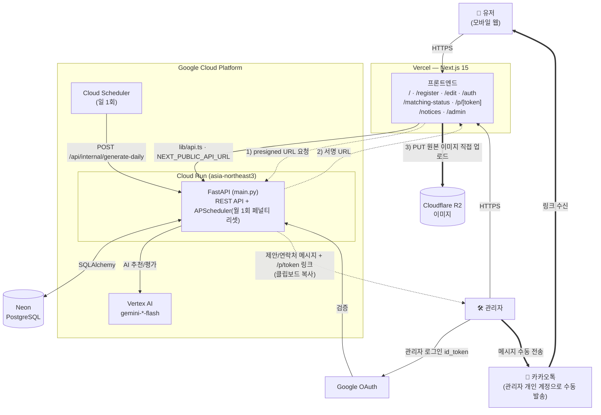
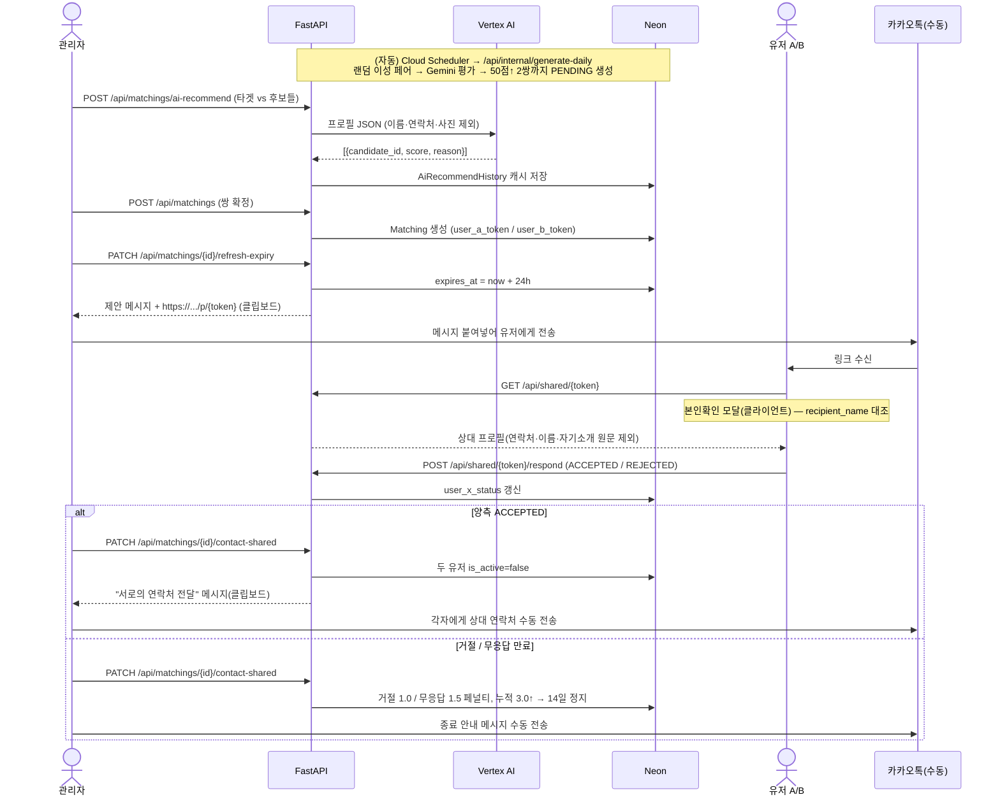

# TwoDegrees 아키텍처

실제 코드 기준([`backend/main.py`](../backend/main.py), [`backend/database.py`](../backend/database.py), [`backend/utils/`](../backend/utils/), [`frontend/lib/api.ts`](../frontend/lib/api.ts), [`frontend/app/admin/page.tsx`](../frontend/app/admin/page.tsx)).

## 구성요소

| 레이어 | 기술 | 배포 | 비고 |
|---|---|---|---|
| 프론트엔드 | Next.js 15 (App Router), React 19, TS | **Vercel** (Hobby) | `@vercel/analytics`, `@vercel/speed-insights` |
| 백엔드 | FastAPI (단일 `main.py`), SQLAlchemy 2 | **GCP Cloud Run** (`asia-northeast3`) | 이미지: Artifact Registry |
| DB | PostgreSQL | **Neon** (무료) | 로컬은 SQLite(`twodegrees.db`) |
| 이미지 스토리지 | S3 호환 | **Cloudflare R2** | boto3 presigned URL, 브라우저가 직접 PUT |
| LLM | `google-genai` SDK | **Vertex AI** (`aiplatform`, location `global`) | 로컬 폴백: AI Studio(`GEMINI_API_KEY`) |
| 배치 스케줄 | **GCP Cloud Scheduler** | → `POST /api/internal/generate-daily` (`X-Scheduler-Secret`) | 일일 자동 매칭 |
| 인프로세스 스케줄 | APScheduler | Cloud Run 컨테이너 내 | 매월 1일 00:00 페널티 점수 리셋만 |
| 관리자 인증 | Google OAuth (`@react-oauth/google`) | → `POST /api/admin/login` → JWT(24h) | 허용 이메일 화이트리스트 |
| 알림/전달 | **없음 (수동)** | 관리자가 카카오톡으로 직접 | 카카오 채널은 문의용 외부 링크일 뿐, 시스템 통합 없음 |

## 시스템 다이어그램

## 매칭 라이프사이클 (수동 전달 경로 포함)

## 데이터 흐름 메모

- **이미지**: 백엔드를 경유하지 않는다. 브라우저가 `GET /api/upload/presigned-url`로 서명 URL만 받고 R2에 직접 PUT, 공개 URL을 `users.photo_urls`에 저장.
- **LLM 입력**: `utils/gemini.py`가 타겟+후보의 프로필 JSON에서 `name`·`referrer_name`·`photo_urls`를 제외하고 프롬프트에 임베드. 후보 ID는 `B1`, `B2` 라벨로 치환 후 응답에서 원복.
- **세션**: 일반 유저는 세션/토큰이 없다. 로그인은 `user_id` 반환뿐이고 이후 요청은 UUID로 식별. 관리자만 JWT(쿠키 저장).
- **자동 매칭 중복 방지**: 일일 매칭은 APScheduler가 아니라 Cloud Scheduler 단일 트리거로만 실행(컨테이너 다중 인스턴스 시 중복 생성 방지 목적, 코드 주석 명시).
