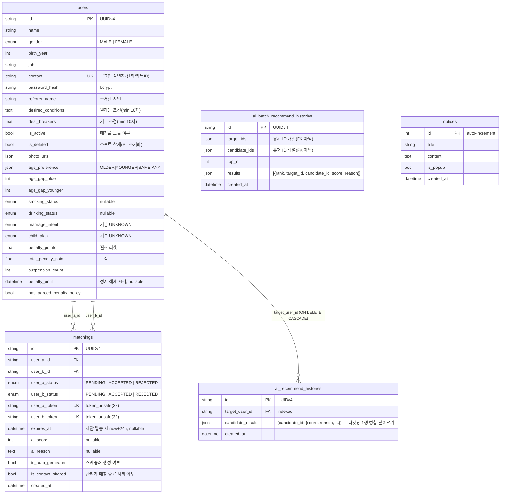

# TwoDegrees ERD

SQLAlchemy 모델([`backend/models.py`](../backend/models.py)) 기준. 주요 컬럼만 표기(전체 컬럼은 모델 파일 참조).

- DB: 로컬 SQLite / 운영 Neon PostgreSQL ([`backend/database.py`](../backend/database.py))
- ID: `users` / `matchings` / `ai_*` 는 애플리케이션 생성 UUIDv4 문자열(PK). `notices` 만 정수 auto-increment.
- 마이그레이션: Alembic 없음. 앱 시작 시 `Base.metadata.create_all` + `main.py` 내 수동 `ALTER TABLE`(idempotent).
- 모델에 `relationship()` 정의는 없고 `ForeignKey` 컬럼 제약만 존재. `ai_batch_recommend_histories` 는 유저 참조를 JSON 배열로만 보관(FK 없음).

## 제약·인덱스

| 테이블 | 제약 |
|---|---|
| `users` | `contact` UNIQUE |
| `matchings` | `user_a_token` UNIQUE, `user_b_token` UNIQUE, `UNIQUE(user_a_id, user_b_id)` (`uq_matching_user_a_b`) — 매칭 생성 시 두 ID를 문자열 정렬해 저장 |
| `ai_recommend_histories` | `target_user_id` INDEX, FK `ON DELETE CASCADE` |

## Enum 값

| Enum | 값 |
|---|---|
| `Gender` | `MALE`, `FEMALE` |
| `MatchStatus` | `PENDING`, `ACCEPTED`, `REJECTED` |
| `SmokingStatus` | `NON_SMOKER`, `SMOKER` |
| `DrinkingStatus` | `NON_DRINKER`, `SOCIAL_DRINKER`, `DRINKER` |
| `MarriageIntent` | `UNKNOWN`, `WILLING`, `OPEN`, `NOT_NOW`, `NON_MARRIAGE` |
| `ChildPlan` | `UNKNOWN`, `WANT`, `OPEN`, `NOT_NOW`, `DINK` |
